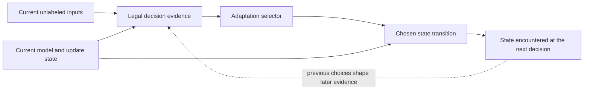

# Shift-aware test-time adaptation: deep literature review, novelty audit and proposed study

Review date: **26 October 2026**. Status: literature investigation and experimental design. **No new model experiment or benchmark result accompanies this report.** The user explicitly authorized reassessing novelty from scratch; the earlier gate, acquisition proposal and digit results do not determine the recommendation below.

The library now contains **103 distinct records: 101 scholarly sources and two benchmark documentation records**. This refresh added 55 records and freshly inspected 68 distinct sources, with different reading depths. The other records retain their earlier reading status. This is an extensive targeted review, not a claim of database completeness or 101 full-paper readings. See [references](../REFERENCES.md), [BibTeX](../references.bib), [catalog](../sources/catalog.json) and [provenance](shift-aware-tta-deep-review-2026-10-26.provenance.md).

## 1. Decision on the original proposal

**“Infer a shift, then select or compose a suitable adaptation” is already an established direction.** It cannot by itself support a genuine novelty claim. Three direct predecessors make this clear:

- **SLRF** detects aligned/weak/strong shift levels and selects corresponding adaptation strategies. Its publisher abstract establishes this overlap; the subscription-only full method remains an unresolved exact-overlap check. [Su2026SLRF, abstract](https://link.springer.com/article/10.1007/s10618-026-01222-x).
- **MORPHEUS** uses source-model entropy and feature geometry to predict which complete TTA procedure will perform best, before running the selected procedure. Its auxiliary development stage does execute and score candidate methods. It is an ICLR 2026 **TTU workshop** paper. [Danilowski2026MORPHEUS, §2](https://theyoungkwon.github.io/papers/articles/danilowski_morpheus_iclr-ttu26.pdf).
- **Hybrid-TTA** uses evolving teacher/student discrepancy to switch between full and adapter tuning. Thus even a controller that reacts to the model's current history has a close visual predecessor. [Park2025HybridTTA, §4.1](https://arxiv.org/html/2409.08566v2).

The best candidate identified by this review is narrower:

> **Can an adaptation selector remain reliable on the model states created by its own previous choices, rather than only on source-reset or externally generated adaptation trajectories?**

The possible paper would establish the size and mechanism of this failure in visual classification, then investigate a minimal correction. It must go beyond known state-aware heuristics and known training on learner-generated states. **This is a candidate gap, not a verified untouched problem, successful method or conference-ready contribution.** Section 7 explains the collisions; Sections 8–10 define a study that can reject the idea early.

Two sentences in the supplied abstract also need revision. Existing methods do not all apply an invariant adaptation rule. And a final sentence saying the approach “demonstrates improved generalization” must wait for actual evaluation. The four named benchmark families are possible evaluation settings, with substantially different protocols.

## 2. What has to be inferred—and what cannot be assumed

Intuition: noticing a camera image looks different does not tell us which update will help. A classifier can be confidently wrong, uncertain but already optimal among available actions, or accurate before a harmful update.

For an illustrative example, suppose a camera sees mostly trucks. Concentrated truck predictions could reflect a real increase in trucks, or fog causing many non-trucks to be classified as trucks. Rebalancing predictions can help the second case and hurt the first. This is an explanation, not a new discovery: prior-aware normalization, refinement and selection papers already investigate these distinctions. [Park2023LSA](https://arxiv.org/abs/2308.08810), [Jang2025DART](https://arxiv.org/abs/2411.15204), [Vianna2025ChannelSelective](https://proceedings.mlr.press/v274/vianna25a.html).

Keep the following variables separate:

| Variable | Plain meaning | Why it changes the adaptation decision |
| --- | --- | --- |
| Nuisance/appearance change | Lighting, noise, blur, style or viewpoint changes the observations. | The useful correction depends on which information survives and what the action can repair. A label-preserving image transformation does not automatically satisfy the strict statistical covariate-shift assumption. |
| Class-prior change | The frequencies of known classes change. | A batch mean or dominant predicted class may change even without any sensor fault. |
| Conditional/semantic change | The relationship between observations and labels changes, or unknown classes appear. | A closed-set classifier cannot create missing classes merely by minimizing entropy. |
| Stream structure | Correlation, ordering, dwell time and batch composition change. | The same image multiset can produce different updates and method rankings. |
| Live adaptation state | Weights, normalization buffers, optimizer, teacher, memory and counters change. | The effect of the next update depends on where the earlier updates left the system. |
| Information and cost budget | The controller sees one pass, extra views, source statistics, candidate updates or future samples. | An apparently better selector may simply have more information or execute much more computation. |

The strict label-shift assumption fixes class-conditional input distributions while class frequencies change. Black-box prior estimation then needs additional conditions, such as a usable source confusion matrix. Simultaneous nuisance changes can invalidate that matrix; estimating a target prior is not a solved arbitrary-shift subroutine. [Lipton2018BBSE](https://proceedings.mlr.press/v80/lipton18a.html), [Jeong2026CalibrationAware](https://proceedings.mlr.press/v337/jeong26a.html).

There are fundamental information limits. General unlabeled accuracy estimation requires assumptions; an adaptation selector likewise cannot distinguish deployments that look identical through its allowed observations but require different actions. This blocks promises of physical-cause identification or universally safe adaptation from entropy and marginal moments alone. [Garg2022ATC, §3.1](https://arxiv.org/abs/2201.04234), [Jhawar2026Identifiability, §§3.1–3.5](https://arxiv.org/html/2609.11235v1).

## 3. Research directions, benchmark relevance and individual hindrances

The table describes mechanisms and scope, not a pooled SOTA ranking. “Hindrance” means a documented qualification or a clearly identified mechanistic limitation; it does not mean every descendant has failed to address it. Primary-paper notes distinguish authors' statements from our interpretation.

| Direction and relevant work | How it seeks better benchmark performance | Where it is relevant | Main hindrance / what must still be measured |
| --- | --- | --- | --- |
| **Strong source models and robust training:** AugMix, DeepAugment, RobustBench checkpoints | Improves the representation before deployment; can complement adaptation. | Corruption and natural-shift baselines. | Source quality changes both error and adaptation headroom. A new method compared with a weak source can look valuable for the wrong reason. Robustness on one shift family does not establish robustness on another. [AugMix](https://arxiv.org/abs/1912.02781), [Many Faces](https://openaccess.thecvf.com/content/ICCV2021/html/Hendrycks_The_Many_Faces_of_Robustness_A_Critical_Analysis_of_Out-of-Distribution_ICCV_2021_paper.html). |
| **Statistics adaptation:** AdaBN, BN-Adapt, DUA, TTN | Re-estimates or interpolates feature means/variances without full retraining; TTN uses source-stage shift sensitivity. | Particularly useful corruption controls on BN networks. | Small, correlated, mixed-domain or class-skewed batches can give unsuitable statistics. BN-specific gains do not directly transfer to LayerNorm/GroupNorm architectures. [BN-Adapt](https://papers.neurips.cc/paper_files/paper/2020/hash/85690f81aadc1749175c187784afc9ee-Abstract.html), [DUA](https://openaccess.thecvf.com/content/CVPR2022/html/Mirza_The_Norm_Must_Go_On_Dynamic_Unsupervised_Domain_Adaptation_by_CVPR_2022_paper.html), [TTN](https://arxiv.org/abs/2302.05155). |
| **Entropy and reliable-sample optimization:** Tent, ETA/EATA | Makes predictions confident; filters unreliable/redundant examples and protects important parameters. | Essential CIFAR-C/ImageNet-C baselines. | Confidence can reinforce errors. Learning rate, steps, batch composition and source-derived regularization matter. ETA and EATA have different preparation requirements. [Tent](https://arxiv.org/abs/2006.10726), [EATA](https://proceedings.mlr.press/v162/niu22a.html). |
| **More stable/reliable objectives:** SAR, DeYO, EATA-C | Flat-minimum updates, transformation-derived reliability, or separating model/data uncertainty reduce unstable self-training. | Wild/mixed shifts and small-batch corruption settings. | Reliability proxies and perturbations have assumptions; extra forward/backward/subnetwork work is real cost. Reducible uncertainty and repairability are already research topics. [SAR](https://arxiv.org/abs/2302.12400), [DeYO](https://arxiv.org/abs/2403.07366), [EATA-C](https://arxiv.org/abs/2403.11491). |
| **Teachers, replay and restoration:** CoTTA, RMT, RoTTA, NOTE | Smooth predictions, retain source knowledge and use balanced/recent memories across changing conditions. | Continual/gradual corruption, temporal correlation, DomainNet-126. | Pseudo-label errors accumulate; memory can become stale; teacher/replay costs and source access differ. A method may improve short streams but deteriorate later. [CoTTA](https://openaccess.thecvf.com/content/CVPR2022/html/Wang_Continual_Test-Time_Domain_Adaptation_CVPR_2022_paper.html), [RMT](https://openaccess.thecvf.com/content/CVPR2023/html/Dobler_Robust_Mean_Teacher_for_Continual_and_Gradual_Test-Time_Adaptation_CVPR_2023_paper.html), [NOTE](https://arxiv.org/abs/2208.05117). |
| **Prior/imbalance-aware adaptation:** DELTA, TRIBE, ROID, LSA, DART, Hybrid-TTN, LATTA | Separates or compensates for class-mixture effects in normalization, sample weighting, logits or adapters. | Corruption plus prior shift; locally correlated and partially overlapping class streams. | Pseudo-labels can confuse true imbalance with prediction collapse. Some approaches need labeled-source preparation; partial class absence and persistent BN drift are already covered. [DELTA](https://arxiv.org/abs/2301.13018), [TRIBE](https://ojs.aaai.org/index.php/AAAI/article/view/29435), [LATTA](https://openaccess.thecvf.com/content/WACV2026/html/Weerasinghe_Logit-Adjusted_Test-Time_Adaptation_under_Partial_Class_Imbalance_WACV_2026_paper.html). |
| **Input-dependent experts:** BECoTTA, MoETTA, MoASE++, TiME | Allocates/composes specialized experts to reduce interference across conditions. | Heterogeneous continual streams; some methods target segmentation or language. | Expert allocation, memory, training overhead and routing collapse need accounting. Expert mixture is already dynamic composition; unseen combinations are not automatically solved. [BECoTTA](https://proceedings.mlr.press/v235/lee24ab.html), [MoETTA](https://arxiv.org/abs/2511.13760), [TiME](https://proceedings.mlr.press/v306/liu26ec.html). |
| **Shift-conditioned switching:** Hybrid-TTA, SLRF, AdaTent++ | Changes tuning scope or chooses statistics update, gradient update or skip using deployment signals. | Directly overlaps the supplied architecture. | The detector/controller can be wrong or benchmark-specific. Must inspect preparation, domain identifiers and realistic streams; an alarm is not proof of update benefit. [Hybrid-TTA](https://arxiv.org/abs/2409.08566), [SLRF](https://link.springer.com/article/10.1007/s10618-026-01222-x), [AdaTent++](https://doi.org/10.3389/frsip.2026.1842851). |
| **Layer/subspace selection:** GALA, LAW, GOLD | Restricts updates to useful layers or low-dimensional feature directions. | Efficient continual classification/segmentation. | A restricted update may lack needed capacity; selection signals and source preparation matter. GOLD's stated existence result is single-step, not a general multi-step guarantee. [GALA](https://arxiv.org/abs/2404.03784), [LAW](https://github.com/junia3/LayerwiseTTA), [GOLD](https://openaccess.thecvf.com/content/CVPR2026/html/Lai_The_Golden_Subspace_Where_Efficiency_Meets_Generalization_in_Continual_Test-Time_CVPR_2026_paper.html). |
| **Whole-method selection and accuracy estimation:** MORPHEUS, AETTA, TTALine, realistic selection study | Predicts action performance or uses disagreement/proxy validation to select candidates. | Closest comparison family for a learned policy selector. | Before-action selection differs from scoring already-adapted candidates. Auxiliary labels, target access and actual candidate execution must be disclosed. Development generalization is itself a research problem. [MORPHEUS](https://theyoungkwon.github.io/papers/articles/danilowski_morpheus_iclr-ttu26.pdf), [AETTA](https://openaccess.thecvf.com/content/CVPR2024/html/Lee_AETTA_Label-Free_Accuracy_Estimation_for_Test-Time_Adaptation_CVPR_2024_paper.html), [TTALine](https://arxiv.org/abs/2310.04941), [Cygert et al.](https://doi.org/10.5220/0014320100004084). |
| **Monitoring, protected updates and resets:** POEM, Monitoring Risks, RDumb, ASR | Detects degradation, limits harmful updates, or restores source knowledge. | Long streams, source returns and collapse. | Label-free risk statements require proxy assumptions. Resetting trades recovery against losing useful state. Fixed periodic reset is a serious baseline. [POEM](https://arxiv.org/abs/2408.07511), [Monitoring](https://arxiv.org/abs/2507.08721), [RDumb](https://arxiv.org/abs/2306.05401), [ASR](https://arxiv.org/abs/2603.03796). |
| **Self-supervision and augmentation:** TTT, TTT-MAE, MEMO | Uses rotation, reconstruction or multi-view consistency instead of labels. | One-sample and general corruption/natural-shift adaptation. | Auxiliary-task preparation and invariance assumptions differ. Better reconstruction or consistency can be task-irrelevant; many views and repeated optimization can be expensive. [TTT](https://proceedings.mlr.press/v119/sun20b.html), [TTT-MAE](https://proceedings.neurips.cc/paper_files/paper/2022/hash/bcdec1c2d60f94a93b6e36f937aa0530-Abstract-Conference.html), [MEMO](https://papers.neurips.cc/paper_files/paper/2022/hash/fc28053a08f59fccb48b11f2e31e81c7-Abstract-Conference.html). |
| **Output/prototype/cache adaptation:** SHOT, T3A, LAME, TDA, FreeTTA, StatA | Refines decision geometry or target distributions, often without backpropagation. | Natural domains and VLM recognition; inexpensive controls. | Requires informative representations and pseudo-labels. Graph/cache/modeled-distribution errors can be persistent; full-target clustering is a stronger access regime than streaming. [SHOT](https://proceedings.mlr.press/v119/liang20a.html), [T3A](https://proceedings.neurips.cc/paper_files/paper/2021/hash/1415fe9fea0fa1e45dddcff5682239a0-Abstract.html), [LAME](https://openaccess.thecvf.com/content/CVPR2022/html/Boudiaf_Parameter-Free_Online_Test-Time_Adaptation_CVPR_2022_paper.html), [TDA](https://arxiv.org/abs/2403.18293), [StatA](https://arxiv.org/abs/2501.03729). |
| **Feature/nuisance correction:** TACT, Mint, Drift-TTA | Removes transformation-sensitive feature directions, restores class geometry or learns trajectory correction. | VLM and supervised corruption robustness. | Nuisance transformations must preserve useful content; pseudo-label geometry changes with priors. Offline correction training is additional preparation. [TACT](https://arxiv.org/abs/2510.11133), [Mint](https://arxiv.org/abs/2510.22127), [Drift-TTA](https://arxiv.org/abs/2610.24220). |
| **Multiple adaptation hypotheses:** Multi-Hypothesis TTA | Maintains diversified parameter trajectories to reduce dependence on a single low-entropy solution. | Corruption and additional domain/spurious-correlation tests. | Low entropy does not uniquely specify a useful solution. Multiple particles cost approximately multiple executions; diversity and weighting still need tuning. [Shamsi2026MultiHypothesis](https://arxiv.org/abs/2607.00259). |
| **Budget, latency and evidence allocation:** time-constrained evaluation, Tempora, BoTTA, SA-TTS | Matches updates/probes to time, samples, memory or inference budgets. | Edge deployment and realistic efficiency comparisons. | FLOPs, trainable parameters and actual latency differ. Probe/candidate/teacher/state-copy costs can eliminate accuracy gains. [Alfarra2024TimeConstraints](https://proceedings.mlr.press/v235/alfarra24a.html), [Tempora](https://proceedings.mlr.press/v306/sreeram26a.html), [BoTTA](https://doi.org/10.1145/3774906.3800498), [SA-TTS](https://openaccess.thecvf.com/content/CVPR2026W/Viscale/html/Yang_SA-TTS_Stress-Aware_Test-Time_Scaling_for_Vision_Models_CVPRW_2026_paper.html). |
| **Open-set adaptation:** UniEnt and related work | Uses different treatment of known versus unknown inputs instead of forcing every sample into a source class. | Semantic novelty plus nuisance shift. | Unknown/known partition errors contaminate updates. Closed-set accuracy cannot measure unknown detection; this is an additional task, not a free robustness extension. [UniEnt](https://openaccess.thecvf.com/content/CVPR2024/html/Gao_Unified_Entropy_Optimization_for_Open-Set_Test-Time_Adaptation_CVPR_2024_paper.html). |
| **Theory of decisions and recoverability:** action identifiability, recovery complexity, decision-theoretic TTT | Specifies information limits, proxy/task alignment and useful update directions/steps. | Explains why some empirical problems cannot be fixed by a larger router. | Results rely on particular observation channels, model families and assumptions. They do not supply universal unlabeled safety. [Identifiability](https://arxiv.org/abs/2609.11235), [Recovery complexity](https://proceedings.mlr.press/v306/zhou26be.html), [Decision-theoretic TTT](https://proceedings.mlr.press/v306/wakayama26a.html). |

A practical implication is that the competitor is no longer just Tent. A corruption study should include a good frozen source, a statistics baseline, strong reliable-update methods and a robust continual method. A selection paper additionally needs learned selection and strong skip/reset controls. A VLM paper has a different competitor set: TPT, cache/prototype refinement, StatA, Mint and relevant recent methods. [TTAB](https://proceedings.mlr.press/v202/zhao23d.html), [TTABC](https://arxiv.org/abs/2606.14299).

One concrete **within-study** example: TTABC Table 4 reports CLIP ViT-B/16 corruption-average accuracy of 21.46% for SOURCE, 26.94% for Tent and 34.98% for DeYO. In the same table, natural-shift accuracy is 57.86% for DeYO and 63.01% for prototype-based TPS. This supports different preferred interventions across those specific settings, not a universal winner. These are authors' results, not ours. The v3 natural-average prose and some tables disagree, so numerical use must name its exact table rather than combine inconsistent summaries. [Huang2026TTABC, Table 4](https://arxiv.org/html/2606.14299v3).

## 4. Benchmarks and what “beating the benchmark” means

The detailed [benchmark investigation](../notes/review-refresh-2026-10-26/benchmarks.md) records datasets, metrics, stream construction and toolkit limits. The recommended roles are:

| Benchmark family | Suitable role | Main qualification |
| --- | --- | --- |
| **CIFAR-10-C and CIFAR-100-C** | Small controlled screen; use CIFAR-100-C to challenge a selector beyond a very small class set. | Declare the corruption list, severity aggregation and image split. An unseen severity of a known corruption is a weak novelty/generalization test. |
| **ImageNet-C** | Main large-scale corruption result after a useful effect exists. | Fix source checkpoint, preprocessing, update/predict timing, batch size and resets. Standard 15-corruption/all-severity and severity-5-only results are different. |
| **ImageNet-3DCC** | Transfer to geometry-related transformations outside common 2D corruptions. | Synthetic estimated geometry remains an approximation; underlying ImageNet IDs can overlap other corruption datasets. |
| **ImageNet-V2/A/R/Sketch** | Natural resampling, hard examples and style/representation shifts. | These are different phenomena, not additional severity settings; class subsets/mappings differ. |
| **DomainNet-126** | Natural-domain continual transfer with an established TTA implementation. | Common four-domain/126-class subset; do not label it full DomainNet. Pin source direction and target order. |
| **Full DomainNet** | Broader domain adaptation if resources and protocol justify it. | Six domains/345 classes; source-free, multi-source, full-target and streaming access are distinct tasks. |
| **WILDS: selected datasets** | External real-shift evidence with task-specific metrics. | iWildCam uses macro F1, FMoW worst-region accuracy, Camelyon17 average accuracy. Online model updates require a separately declared research protocol and careful rule interpretation. |
| **ACDC/Cityscapes-C** | Optional segmentation transfer once classification findings are established. | Real adverse conditions versus synthetic corruption; report mIoU and exact dataset/version. Extending task coverage adds substantial implementation work. |

Dataset sources: [corruptions](https://github.com/hendrycks/robustness), [3DCC](https://3dcommoncorruptions.epfl.ch/), [DomainNet](https://ai.bu.edu/M3SDA/), [WILDS](https://wilds.stanford.edu/datasets/), [ACDC](https://openaccess.thecvf.com/content/ICCV2021/html/Sakaridis_ACDC_The_Adverse_Conditions_Dataset_With_Correspondences_for_Semantic_Driving_ICCV_2021_paper.html). Natural-shift dataset paper records are in the bibliography.

**Metrics:** raw corruption error is the average fraction misclassified. Original ImageNet-C **mCE** normalizes each corruption's errors against an AlexNet reference before averaging; it is not another name for raw mean error. Macro F1 gives equal weight to classes' F1 scores; worst-region accuracy asks how the least successful region performs; segmentation mIoU measures overlap between predicted and true regions. A high overall accuracy can coexist with poor minority-group performance. [Corruption benchmark](https://arxiv.org/abs/1903.12261), [WILDS official metrics](https://wilds.stanford.edu/leaderboard/).

**WILDS rule boundary:** standard submissions forbid test-set training/model selection and evaluation batch statistics. Non-standard submissions retain the test-training/selection prohibition. The leaderboard also contains historical ARM-BN and test-time BN baseline rows; these do not establish permission for a new test-trained submission. We make no blanket ruling on every inference-only refinement. Designated WILDS 2.0 unlabeled data supports adaptation before final evaluation under a different access regime. [Submission rules](https://wilds.stanford.edu/submit/), [WILDS unlabeled extension](https://arxiv.org/abs/2112.05090).

### Existing benchmark programs already address much of the realism argument

- **TTAB** documents tuning sensitivity, source-model dependence and difficult class/temporal shifts. **Yu et al.** provide another broad classification benchmark. [TTAB](https://proceedings.mlr.press/v202/zhao23d.html), [Benchmarking TTA](https://arxiv.org/abs/2307.03133).
- **UniTTA** models domain/class correlation and imbalance. The inspected paper defines 36 combinations and evaluates 24 settings; its method also maintains domain/class-sensitive statistics. This blocks claiming mixed-class/domain evaluation itself as new. [Du2024UniTTA, §§3–5](https://arxiv.org/html/2407.20080v1).
- **CCC/RDumb** challenges short-stream success with long continually changing corruptions and simple reset controls. **Tempora** evaluates time-contingent utility; **BoTTA** covers limited samples, incomplete classes, compound corruptions and hardware. [RDumb](https://arxiv.org/abs/2306.05401), [Tempora](https://proceedings.mlr.press/v306/sreeram26a.html), [BoTTA](https://doi.org/10.1145/3774906.3800498).
- **TTABC** finds different CLIP update paradigms favorable under different shift regimes and names dynamic selection as future work. That statement does not remove independent routing precedents. Its author-reported NeurIPS 2026 status has not been independently confirmed from proceedings in this review. [Huang2026TTABC, Appendix B](https://arxiv.org/html/2606.14299v3).
- A **living TTA leaderboard** exists with protocol/model selectors and efficiency reporting. The inspected reproduction-code link remains marked TBD. Use it for orientation, and verify a chosen comparison in accessible pinned code. [Leaderboard](https://test-time.cc/tta-leaderboard/).

There is therefore no defensible universal “best TTA score.” Compare within a fixed dataset, checkpoint, source preparation, information access, timing, order, batch size and cost budget. This report deliberately avoids a misleading table assembled from incomparable headline accuracies.

## 5. Novelty collisions to resolve before writing a method paper

| Potential claim | Closest collision | Assessment |
| --- | --- | --- |
| Infer shift strength and choose an update. | SLRF; Hybrid-TTA; AdaTent++. | Established broad design. |
| Predict the best whole TTA method from unlabeled features. | MORPHEUS. | Direct collision. |
| Dynamically compose adaptation experts. | BECoTTA; MoETTA; MoASE++; TiME. | Established broad design. |
| Add a no-update action and use entropy/consistency. | AdaTent++; selective VLM adaptation/CAS; protected adaptation. | Established ingredients. |
| Distinguish prediction collapse from true class concentration. | DELTA; TRIBE; ROID; LSA; DART; Hybrid-TTN; LATTA. | Necessary control problem, insufficient novelty alone. |
| Same coarse observations can need opposite actions. | Jhawar and Wang's action-identifiability study. | Explicit theoretical/empirical predecessor. |
| Acquire extra views only when useful. | SA-TTS; CAS; SEGA; general value-of-information work. | Conditional evidence acquisition is established. |
| Use source/live disagreement or accumulated displacement. | ASR; GALA; Hybrid-TTA. | These signals and state-aware control are established. |
| Learn adaptation decisions from persistent state and local counterfactuals. | Agentic-TTT; learned adaptation controllers such as RNA. | Established general control precedent. |
| Train on states visited by the learner. | DAgger; Agentic-TTT explicitly identifies autonomous-history exposure bias. | Established learning principle; exact visual-TTA problem remains a candidate scope. |

Sources for less central rows: [CAS](https://arxiv.org/abs/2609.08367), [SEGA](https://arxiv.org/abs/2608.29920), [adaptive value of information](https://proceedings.neurips.cc/paper_files/paper/2013/hash/ebd9629fc3ae5e9f6611e2ee05a31cef-Abstract.html), [RNA](https://rapid-network-adaptation.epfl.ch/), [DAgger](https://proceedings.mlr.press/v15/ross11a.html). Full overlap notes and source locations are in the [researcher investigation](../notes/review-refresh-2026-10-26/researcher.md) and [independent verification](../notes/review-refresh-2026-10-26/verifier.md).

Some important 2026 sources here are preprints or workshops. They still constrain originality. Their unverified acceptance or unreplicated numerical claims should not be elevated to established benchmark facts. Conversely, an inaccessible full text cannot be assumed to omit our proposed experiment.

## 6. Candidate gaps ranked by the next evidence needed

This is a prioritization of research questions, not novelty or publication scoring.

| Candidate | Literature-supported opening | What could make it substantive | Main reason to reject it |
| --- | --- | --- | --- |
| **A. Selector reliability under its own adaptation-state distribution** — recommended first diagnostic | Source-reset whole-method selection and live-state heuristics leave a specific empirical comparison to investigate: matched current inputs, different inherited states, then autonomous policy deployment. | A material, reproducible failure beyond current predictions/reset heuristics, explained mechanistically and improved with a carefully controlled state representation or training design. | Standard resets/current-output features or plain equal-budget dataset aggregation solve everything; no TTA-specific finding remains. |
| **B. Detect when label-free monitoring proxies stop being informative** | Monitoring Risks explicitly leaves unlabeled diagnostics of proxy-assumption violations open; POEM discusses unwanted reactions to label shift. | A restricted shift-family diagnostic with explicit assumptions and useful abstention/monitoring behavior. | Identifiability fails under allowed shifts, or diagnostic success is just known prior correction/uncertainty. Universal certification is unavailable. |
| **C. Interaction between actions under compound shifts** | Specialist actions need not combine constructively. | Quantify a specific interaction and predict when composition helps beyond strong expert-routing/compound-shift controls. | Simply evaluating compound corruptions duplicates BoTTA; generic composition duplicates mixtures; action-order effects alone are unsurprising. |

For B, the primary explicit limitation is [Monitoring Risks, §6](https://arxiv.org/html/2507.08721v2), not an inference that nobody has studied monitoring. For C, absent an identified mechanism, the existing literature makes it a weaker starting point. The earlier costly-evidence approach and three-feature gate are not being recommended merely because this project previously explored them.

## 7. Recommended question and its exact remaining novelty boundary

Working question: **When does a shift-aware selector fail because its own previous adaptations have changed the action effects it learned?**

The feedback loop is established control machinery. The proposed study asks whether it creates a consequential, insufficiently measured failure in visual adaptation selection.

Imagine two identical current foggy batches. One classifier reaches them after useful adaptation to related fog; another after a long, skewed rain stream. A new update can help one and hurt the other. A source-only shift descriptor cannot see that distinction. A descriptor from the current model can see some of it; optimizer/memory state can contain additional information. This is an illustrative hypothesis. Showing merely that different weights behave differently would be trivial.

The distinct investigation has three parts:

1. **State-conditioned action effects:** measure how much action benefit changes with realistic earlier adaptation, while present support/query images and order are identical.
2. **Autonomous selector failure:** determine whether a selector that looks good on logged fixed-policy states degrades when its decisions generate later states.
3. **Correction beyond obvious controls:** test whether explicit state evidence and appropriately collected development trajectories help beyond current predictions, source resets and ordinary dataset aggregation.

The closest-art boundaries are narrow. The identifiability paper's §4.1 starts candidate procedures from a common frozen source state for each world; it already varies whole-stream structure. ASR and GALA already react to live state; ASR also examines imbalanced streams and variable dwell times. We must compare their mechanisms, not claim those settings are absent. [Jhawar2026Identifiability, §4.1](https://arxiv.org/html/2609.11235v1), [ASR, §§3.3–3.5 and §4.4](https://arxiv.org/html/2603.03796v1), [GALA, §§2.2–2.3](https://arxiv.org/html/2404.03784v2).

Agentic-TTT is an especially important recent neighbor: it learns persistent-state decisions and uses same-snapshot counterfactual trajectories. Its Appendix E explicitly identifies gold-history versus autonomous-history exposure bias and leaves autonomous-stream credit assignment for future work. Therefore neither this mismatch nor its general solution is our invention. The possible visual contribution must be an important measured failure, a specific mechanism, and a correction that survives strong baselines. [Lu2026AgenticTTT, §2.2.2 and Appendix E](https://arxiv.org/html/2610.12002v1).

**Potential contribution statement, conditional on evidence:** a controlled visual-TTA study separating external shift from action-induced state, with a selector evaluation protocol that exposes replay-to-autonomous failure, plus a minimal correction that improves useful adaptation on untouched streams. A new router name, three features or an MDP diagram would not establish that contribution.

## 8. Proposed approach: state-conditioned action-value prediction

Start with simple operations whose state transitions are unambiguous. Do not begin by splicing incompatible complete algorithms together.

Let a state contain everything that can affect future predictions or updates:

\[
s_t=(w_t,b_t,o_t,m_t,c_t,r_t),
\]

where \(w_t\) are adaptable weights, \(b_t\) normalization buffers, \(o_t\) optimizer state, \(m_t\) any memory/teacher state, \(c_t\) update/reset counters, and \(r_t\) random-number state. Some components are absent in the smallest implementation. The immutable source checkpoint and external stream clock are stored separately. KEEP preserves predictive/learning state while elapsed-time bookkeeping advances.

Keep actions distinct:

| Action | Prediction behavior | Persistent consequence |
| --- | --- | --- |
| **KEEP** | Use the current adapted model. | Preserve its state; skip learning. |
| **NORMALIZE** | Future predictions use support-updated statistics. | Update only the declared normalization buffers. |
| **UPDATE** | Future predictions use one declared reliable entropy update. | In the minimal action, optimize normalization affine parameters with frozen live running statistics; leave BN buffers unchanged. |
| **RESET** | Future predictions use the source checkpoint. | Restore all declared state components, including optimizer/buffers. |
| **SOURCE fallback** | Answer with the immutable source model. | By definition here, preserve the live adapted state for future decisions. This differs from RESET. |

The primary selectable transitions are KEEP/NORMALIZE/UPDATE/RESET; SOURCE is a separate baseline policy. A selectable source answering path is a later extension requiring a joint output/transition contract, duration and all forward costs. UPDATE's reliable entropy filter is ETA-inspired, but its frozen-statistics semantics differ from native ETA/Tent: it is a diagnostic primitive, not a reproduction. NORMALIZE changes only declared support-derived BN buffers, with interpolation fixed on development. Strong complete TTA methods remain separate comparators. A shared BN backbone supports the statistics action; a LayerNorm-only backbone requires a different declared menu.

Use two kinds of observations:

- **Input/shift evidence \(z_t\):** frozen-source entropy, margins, predicted-class composition and fixed ordered-window summaries from the available unlabeled support.
- **State evidence \(u_t\):** current-model logits, feature geometry and ordered summaries mirroring the source-side evidence, followed by source/current disagreement, parameter/buffer displacement, update/reset age and compact optimizer/memory summaries where relevant.

These features are established ingredients. Evaluate incremental value over **rich current-model evidence**, not only over an intentionally blind source detector or a few current entropy statistics. Every observation forward must be state-pure: no BN writes, teacher updates, memory insertion, gradients or changed dropout behavior. A frozen-source pass may be additional runtime; parameter scans, copies and memory processing are also costs.

Train a small predictor \(\widehat L_\theta(a,z_t,u_t)\) of each action's subsequent loss, and select

\[
a_t=\arg\min_{a\in\mathcal A}
\left[\widehat L_\theta(a,z_t,u_t)+\lambda\widehat C(a,z_t,u_t)\right].
\]

Here \(\mathcal A\) is the fixed action menu, \(\widehat C\) predicts measured action execution cost, and \(\lambda\) is a development-fixed exchange rate between error and compute. Report a frontier over predeclared budgets. This equation is standard decision-making machinery, not an algorithmic novelty claim or a risk guarantee.

### Development training and autonomous state coverage

Use labeled **auxiliary development** streams to score actions. At a saved live state, clone the full state, execute each candidate on an unlabeled support batch, and score the resulting predictor on a disjoint subsequent query. Only query outcomes supervise the predictor offline. Target evaluation labels never enter the controller, tuning or stopping.

Compare development data collection from fixed/random policies with data collected by successive frozen versions of the learned selector. Match unique labeled development queries and their permitted reuse, scored action outcomes, candidate steps and state-collection compute; report a frontier when all budgets cannot be equalized. Refit only on development outcomes. This is a DAgger-style baseline/application. If it alone suffices, report that honestly; a new learning-principle claim would be unsupported. [Ross2011DAgger](https://proceedings.mlr.press/v15/ross11a.html).

A short-horizon loss predictor is myopic. It does not solve delayed credit assignment across a stream. The primary target is loss on the **next prediction block**, initially 64 examples. A separate 512-example frozen post-action window estimates a diagnostic fixed-KEEP horizon; it is not a one-decision target. Evaluate longer continuations separately. Only add a sequential objective after showing a failure that one-step prediction cannot address.

### Deployment timing

Use a primary **predict-then-update** stream: predict batch \(B_t\) with the state established before it arrived; then use its unlabeled inputs to choose/update the state for \(B_{t+1}\). No future query inputs enter the current choice. On an update decision, local counterfactual evaluation uses the same observed support and a fixed future query. Query forward passes must not update normalization buffers or gradients.

The optional source fallback can be selected for the next prediction block from current evidence. A secondary same-batch adapt-then-predict experiment is allowed only as a separately labeled protocol. It must not be pooled with the primary causal stream. Short dwell times may make adaptation to the previous batch unsuitable for the next one; that is part of the intended deployment problem, not a reason to use future information.

## 9. Staged experiment that can reject the direction

Detailed protocol: [Experiment 002](../experiments/002-state-conditioned-selection.md). All stages are **planned**.

### Stage 0 — specify a legitimate source/development regime

Use a faithful PyTorch classifier and declared source preparation. One transparent CIFAR-100 option is source training on 45,000 training images, 3,000 auxiliary selector-training images and 2,000 calibration images, with the official test identities untouched. This changes the source training regime from the usual full 50,000; all comparisons must share it and disclose it. An alternative needs a legitimate separate labeled source-validation set or an explicitly acknowledged preparation regime.

Freeze image groups, corruption-family groups, prefix generators, current continuations, seeds, feature definitions, hyperparameter budget and action semantics. Hold out **both history families and current shifts**, not just frames. Also hold out dominant-class identities from selector development while retaining all classes in classifier training. Labels can construct class-skewed research streams; those labels and shift IDs must not appear in runtime observations.

### Stage 1 — establish meaningful state-dependent headroom

Construct prefixes independently of action outcomes: balanced/correlated streams, class-mixture changes, abrupt/gradual nuisance changes and source returns. For each local matched case, prefix original IDs are disjoint from support, query and fresh query-replication IDs. Reach identical held-out present sequences through those prefixes. At each decision, branch actions from the same complete state snapshot, including RNG state. Preserve ties, non-flips and failures. Longer autonomous protocols that revisit images must disclose and group those repetitions separately.

Measure how often action rankings reverse by a meaningful error margin across histories, including realistic **noncollapsed** states. Use paired queries and uncertainty intervals; a one-example difference is not robust evidence of a new phenomenon. Check whether the apparent effect disappears with a stronger fixed procedure or periodic reset.

One useful mechanism ablation holds weights and buffers fixed while retaining versus resetting optimizer memory. Identical current predictions can then lead to different update effects. This is a controlled diagnostic of hidden state, not a first discovery about momentum. If resetting optimizer memory solves the problem cheaply, that becomes a serious alternative to a learned controller.

**Stop** if there is negligible headroom, effects require destructive hyperparameters, or low-cost reset/stateless controls remove them.

### Stage 2 — separate shift evidence from current predictions and deeper state

Use identical predictor capacity, action menu, development outcomes and cost accounting:

1. Source-only global shift summaries.
2. Source-only ordered summaries, reflecting the recent identifiability predecessor.
3. Rich current-model logits, feature geometry and ordered summaries, mirroring the source-side representation.
4. That same current-model evidence plus the proposed state descriptors.
5. Age/reset/entropy thresholds and a development-selected fixed action.

Feature ablations must be compared under matched inference costs or shown on a cost frontier. Require improvement beyond rich current-model evidence; beating a source-only baseline does not establish hidden-state value. Labels only train/calibrate the selector on development data. Use predeclared tie/margin handling and an independent query repetition to check that empirical argmin flips are not finite-query noise.

### Stage 3 — measure the gap between replay and autonomous deployment

Evaluate each selector first on saved states, then freely on full held-out streams where it creates its own successor states. Compare fixed-policy development, broader random-policy coverage and learner-state aggregation at equal counts of action scoring and equal training budgets. Report performance of aggregation without any proposed special feature/model.

The key result would be a reproducible **interaction**: a selector's apparent replay advantage fails autonomously, a diagnosed state component explains the failure, and the correction transfers. A general increase from more labeled development outcomes is insufficient.

### Stage 4 — scale only after the diagnostic survives

Confirm across source seeds and another normalization architecture, then ImageNet-C and DomainNet-126. Add a natural-shift/WILDS-derived study with explicitly different access rules if it addresses the observed mechanism. Do not promise results on every named dataset before the first diagnostic.

For shared-backbone, shared-access comparisons include SOURCE, normalization, ETA/EATA as applicable, SAR/DeYO, ROID/RoTTA, RDumb and ASR/GALA or Hybrid-TTA where their original architecture/task can be faithfully matched. Include MORPHEUS-style selection and the strongest legal source-only ordered selector. If a method needs a different backbone, source training or task, report that comparison separately rather than forcing an undocumented port.

## 10. Metrics, comparisons and rejection rules

Explain selection metrics alongside classifier accuracy:

- **Error/accuracy:** wrong/right predictions among scored examples, with per-shift and per-group results.
- **Harm relative to SOURCE:** \(R_{\rm policy}-R_{\rm source}\); positive values mean harm. Also compare against KEEP at the same live state.
- **Harmful-update rate:** fraction of evaluated decisions where an update's subsequent error exceeds the specified reference by a predeclared tolerance; report severity as well as frequency.
- **Local action regret:** chosen action loss minus the lowest loss among candidates branched from that **same** state/support/query. It measures local selection quality, not optimality over the whole stream.
- **Tail risk:** worst-family/group error and predeclared severe-harm frequency; a mean can hide rare collapse.
- **Replay-to-autonomous gap:** change in policy performance between externally supplied states and its own realized trajectories, under matched external input streams. It is a diagnostic, not an unbiased single-number causal estimator unless the state sampling/weighting is specified.
- **Compute:** source and live passes, feature extraction, candidate/shadow runs, gradients, resets, state copies, memory, peak device memory and end-to-end latency/throughput. Report offline selector-training cost separately.

A hindsight local oracle uses evaluation labels only for diagnosis. Selecting independent best actions on someone else's logged trajectory is not a realizable full-stream oracle. A dynamic oracle must be simulated with its own state transitions and a declared horizon; its search cost may make exact evaluation impractical. Never compare a local-regret result with a dynamic-optimality claim.

Use paired streams/seeds and uncertainty intervals that respect repeated image identities and temporal blocks. Do not treat thousands of correlated frames or matched branches as independent datasets. If many comparisons are reported, predeclare the primary hypotheses and adjust exploratory significance claims appropriately. The proposed repeats, resampling and comparisons are future research experiments, not checks run for this review.

Reject a strong novelty/method claim if:

1. Gains are only against always-update or a weak source.
2. Current prediction features explain all incremental state value.
3. Simple reset/optimizer-reset controls remove the problem.
4. Improvement comes only from extra views, labels, candidate runs or different source preparation.
5. Logged-state success fails during free rollout.
6. Gains disappear on held-out histories, classes, current shift families or a second model.
7. Equal-budget plain dataset aggregation matches the proposed training remedy and no new mechanism/evaluation insight remains.
8. Stronger exact prior art already covers the same controlled question and intervention.

These are useful negative findings. They would justify narrowing or abandoning a method claim, not rewriting the abstract as if broad benchmark improvements had been demonstrated.

## 11. What a credible paper would need, and the immediate next step

A plausible paper would need an important failure mechanism, a clean controlled study that separates it from known issues, a correction with a reason to work, and external results under legitimate information/compute budgets. A small gate or recombination of known components is not enough. A carefully executed negative/diagnostic paper is also a possible outcome, but its contribution would need to exceed existing help/harm and identifiability studies.

The **next concrete step** is to freeze Experiment 002's primary claim and compare its exact scope against SLRF full text if accessible, RNA's training dynamics, ASR/Hybrid-TTA, and Agentic-TTT's state collection. Then implement only Stage 1 when execution is requested and this prospect's environment/compute budget is specified. If Stage 1 has no material residual effect beyond simple controls, do not build the selector.

Useful reading order is recent limitations first: Agentic-TTT Appendix E; Monitoring Risks §6; identifiability §§4 and 7; TTABC Appendix B; ASR methods/ablations; then MORPHEUS and the foundational adaptation methods. The [reference index](../REFERENCES.md) and per-paper notes preserve metadata, inspected sections, implementation links and remaining reading work for the eventual paper bibliography.

Historical results remain in their original files. They do not validate this proposal. No deadline, compute budget, conference acceptance probability or improvement on CIFAR-C/ImageNet-C/DomainNet/WILDS has been inferred or promised.
